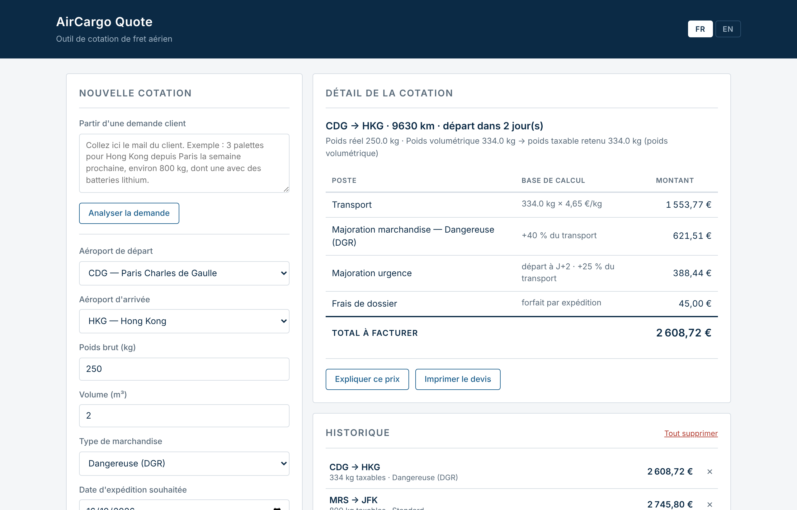
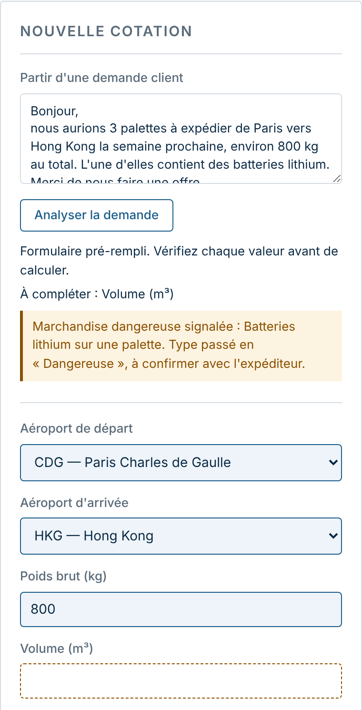
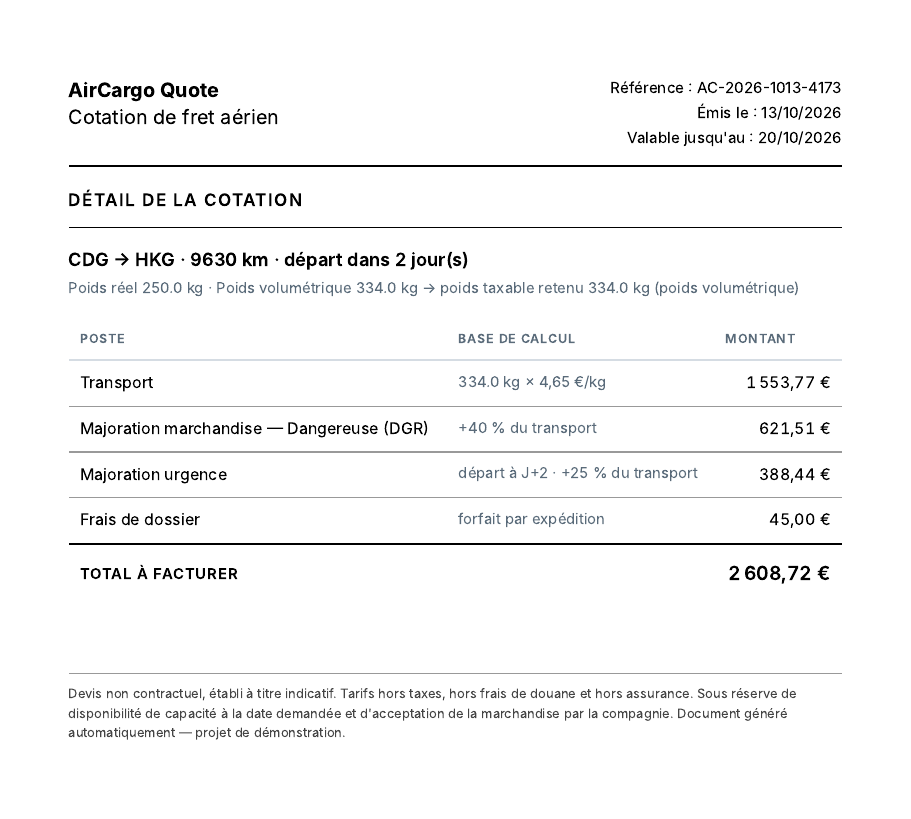
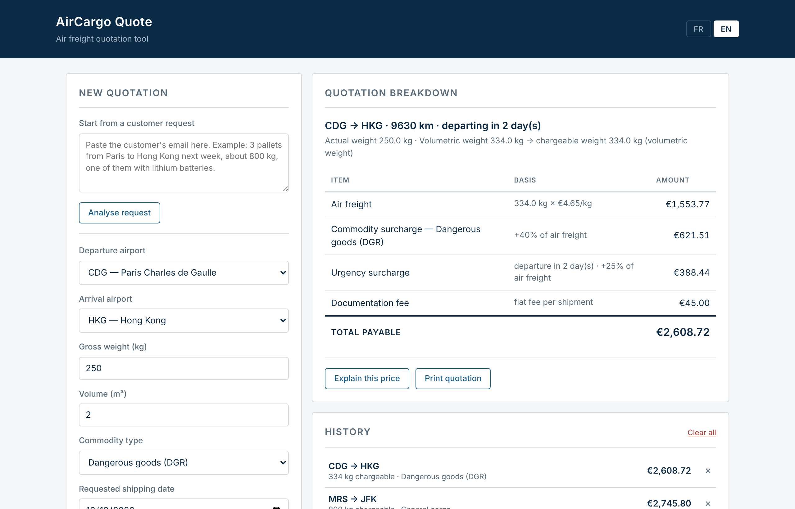

# AirCargo Quote

[](https://github.com/toklivan/aircargo-quote/actions/workflows/tests.yml)

Simulation d'un outil de cotation de fret aérien, écrite en HTML, CSS et
JavaScript sans framework, avec un petit serveur Node.js pour les appels à
l'API Mistral : analyser une demande client et expliquer un prix.

**Démo :** [toklivan.github.io/aircargo-quote](https://toklivan.github.io/aircargo-quote/)
— version statique, sans serveur : l'assistant de saisie et l'explication du
prix y sont désactivés.



| Assistant de saisie | Devis imprimable |
|---|---|
|  |  |



## Fonctionnalités

- **Assistant de saisie** : un mail client collé en texte libre est analysé par
  un modèle Mistral, qui pré-remplit le formulaire. Les champs proposés sont
  surlignés, les champs introuvables sont vidés et signalés, et une alerte
  s'affiche en cas de marchandise dangereuse. Le calcul n'est jamais lancé
  automatiquement : l'agent relit et valide.
- **Cotation** à partir d'un trajet, d'un poids, d'un volume, d'un type de
  marchandise et d'une date d'expédition.
- **Détail du prix ligne par ligne**, avec la base de calcul de chaque ligne :
  - le poids facturé est le plus grand entre le poids réel et le poids
    volumétrique (1 m³ = 167 kg) ;
  - tarif au kilo : 0,80 € + 0,00040 € par kilomètre ;
  - majoration selon la marchandise : fragile +15 %, périssable +20 %,
    dangereuse +40 % ;
  - majoration de 25 % si le départ est dans moins de 5 jours ;
  - 45 € de frais de dossier fixes.
- **Historique** conservé dans le navigateur (localStorage) : consultation,
  suppression d'une cotation ou de tout l'historique.
- **Devis imprimable** avec référence, date d'émission et validité de 7 jours,
  exportable en PDF depuis la boîte d'impression du navigateur.
- **Explication du prix** en langage courant, rédigée par un modèle Mistral à
  partir des montants déjà calculés.
- **Interface en français et en anglais** : textes, formats des montants et
  des dates, devis et explication.

Les tarifs sont fictifs.

## Lancer le projet en local

Prérequis : Node.js 20.6 ou plus récent, et une clé API Mistral
(`console.mistral.ai`).

```bash
cd server
npm install
cp .env.example .env
```

Ouvrir `server/.env` et remplacer la valeur par la clé :

```
MISTRAL_API_KEY=votre_cle
```

Le fichier `.env` est ignoré par Git. `.env.example` sert uniquement de modèle.

Démarrer le serveur :

```bash
cd server
npm start
```

L'application est alors sur `http://localhost:3000`.

Lancer les tests, depuis la racine du projet :

```bash
npm test
```

Sans serveur, en ouvrant `index.html` directement, tout fonctionne sauf
l'assistant de saisie et l'explication du prix.

## Architecture

```
calcul.js             calcul du prix, sans aucun accès à la page
traductions.js        textes français et anglais
script.js             interface : affichage, historique, devis, appels au serveur
server/server.js      proxy vers l'API Mistral
server/extraction.js  vérification des propositions du modèle
tests/                tests unitaires du calcul et de la vérification
```

**Le calcul est séparé de l'interface.** `calcul.js` ne touche jamais à la
page. Le même fichier tourne dans le navigateur et dans Node, ce qui permet de
le tester sans navigateur.

**Pourquoi un serveur Node/Express.** Une clé API ne peut pas être cachée dans
du code qui s'exécute dans le navigateur : n'importe qui peut la lire. La page
appelle donc le serveur, et c'est lui qui appelle Mistral avec la clé lue dans
`.env`. Le serveur ne transmet au modèle que les montants déjà calculés et
n'expose pas le détail des erreurs de l'API.

Au chargement, la page appelle `/api/sante`. Si le serveur ne répond pas,
comme sur GitHub Pages, l'assistant et le bouton d'explication sont désactivés.

**L'assistant de saisie ne fait pas confiance au modèle.** Le modèle répond
en JSON, mais le serveur vérifie chaque valeur avant de la renvoyer :
aéroport présent dans la table de `calcul.js`, poids et volume positifs et
plausibles, type connu, date existante et non passée. Toute valeur hors de
ces règles devient vide. La consigne interdit d'inventer une information ou
d'estimer un volume à partir d'un nombre de palettes : un champ vide se voit,
une valeur approximative non. Dès qu'une marchandise dangereuse est signalée,
le type passe en « Dangereuse », à l'agent de le corriger si l'alerte est
infondée.

Le texte collé est traité comme une donnée non fiable. Il est limité à
2 000 caractères, encadré par des délimiteurs dans le prompt, et seuls les
six champs du formulaire peuvent ressortir de l'analyse : une instruction
glissée dans un mail ne peut ni fixer un prix ni déclencher un calcul.

**Tests et intégration continue.** 28 tests unitaires écrits avec le module
de test intégré à Node (`node:test`), sans dépendance. Pour le calcul, ils
couvrent le choix entre poids réel et poids volumétrique, le seuil exact de
l'urgence et la cohérence entre les lignes du détail et le total. Pour
l'assistant, ils soumettent à la vérification des réponses de modèle fausses
ou piégées, sans appeler l'API. Les dates de test sont
calculées par rapport au jour d'exécution pour ne pas expirer. GitHub Actions
lance les tests à chaque push et à chaque pull request sur `main`.

## Limites connues

- L'historique reste dans le navigateur : il n'est ni partagé ni sauvegardé
  ailleurs.
- Les routes qui appellent Mistral n'ont pas de limitation de débit.
- L'assistant ne traite qu'une expédition par demande et ne connaît que les
  aéroports de la table. Les alertes restent dans la langue du mail.
- Les distances entre aéroports sont stockées en dur et arrondies.
- La comparaison des dates ignore les fuseaux horaires.
- Le PDF dépend du navigateur qui l'imprime.
- Les fichiers JavaScript communiquent par des variables globales plutôt que
  par des modules ES.
- En français, les poids s'affichent avec un point décimal (`334.0 kg`).
- Le vidage de l'historique utilise `confirm()`, qui ne peut pas être stylé.

## Suite du projet

Les prochaines étapes sont décrites dans [ROADMAP.md](ROADMAP.md).
